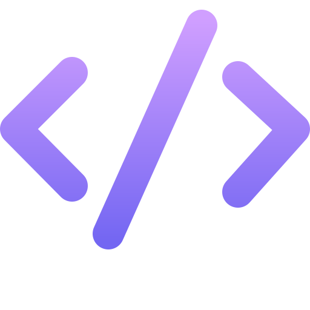

<picture>
  <source
    media="(prefers-color-scheme: dark)"
    srcset="https://github.com/user-attachments/assets/a5fbe818-9810-4302-aafc-103434b068f9"
  />
  <source
    media="(prefers-color-scheme: light)"
    srcset="https://github.com/user-attachments/assets/f02f1378-1ad0-4c5d-916a-8834a7099cdc"
  />
  
</picture>

<h2>
  
  &nbsp;TechStack
</h2>
<table align="center">
  <tr>
    <td align="center"> Python</td>
    <td align="center"> FastAPI</td>
    <td align="center"> Django</td>
    <td align="center"> PostgreSQL</td>
    <td align="center"> Docker</td>
    <td align="center"> AWS</td>
    <td align="center"> Redis</td>
    <td align="center"> Kafka</td>
    <td align="center"> RabbitMQ</td>
    <td align="center"> Grafana</td>
  </tr>
  <tr>
    <td align="center"> C++</td>
    <td align="center"> Rails</td>
    <td align="center"> Ruby</td>
    <td align="center"> MongoDB</td>
    <td align="center"> Linux</td>
    <td align="center"> Git</td>
    <td align="center"> Bash</td>
    <td align="center"> NumPy</td>
    <td align="center"> Pandas</td>
    <td align="center"> pytest</td>
  </tr>
</table>

##
<picture>
  <source media="(prefers-color-scheme: dark)" srcset="https://raw.githubusercontent.com/haishhun/haishhun/output/github-snake-dark.svg" />
  <source media="(prefers-color-scheme: light)" srcset="https://raw.githubusercontent.com/haishhun/haishhun/output/github-snake.svg" />
  
</picture>

  <picture>
    <source media="(prefers-color-scheme: dark)" srcset="https://raw.githubusercontent.com/haishhun/profile-cards/refs/heads/main/assets/profile-dark.svg" />
    <source media="(prefers-color-scheme: light)" srcset="https://raw.githubusercontent.com/haishhun/profile-cards/refs/heads/main/assets/profile-light.svg" />
    
  </picture><picture>
    <source media="(prefers-color-scheme: dark)" srcset="https://raw.githubusercontent.com/haishhun/profile-cards/refs/heads/main/assets/streak-dark.svg" />
    <source media="(prefers-color-scheme: light)" srcset="https://raw.githubusercontent.com/haishhun/profile-cards/refs/heads/main/assets/streak-light.svg" />
    
  </picture>

  <a href="https://github.com/haishhun"><picture><source media="(prefers-color-scheme: dark)" srcset="https://raw.githubusercontent.com/haishhun/profile-cards/refs/heads/main/assets/github-dark.svg" /><source media="(prefers-color-scheme: light)" srcset="https://raw.githubusercontent.com/haishhun/profile-cards/refs/heads/main/assets/github-light.svg" /></picture></a>&nbsp;&nbsp;&nbsp;&nbsp;
  <a href="https://www.linkedin.com/in/dzmitry-haishun/"><picture><source media="(prefers-color-scheme: dark)" srcset="https://raw.githubusercontent.com/haishhun/profile-cards/refs/heads/main/assets/linkedin-dark.svg" /><source media="(prefers-color-scheme: light)" srcset="https://raw.githubusercontent.com/haishhun/profile-cards/refs/heads/main/assets/linkedin-light.svg" /></picture></a>&nbsp;&nbsp;&nbsp;&nbsp;
  <a href="mailto:dzhaishun@gmail.com"><picture><source media="(prefers-color-scheme: dark)" srcset="https://raw.githubusercontent.com/haishhun/profile-cards/refs/heads/main/assets/email-dark.svg" /><source media="(prefers-color-scheme: light)" srcset="https://raw.githubusercontent.com/haishhun/profile-cards/refs/heads/main/assets/email-light.svg" /></picture></a>

